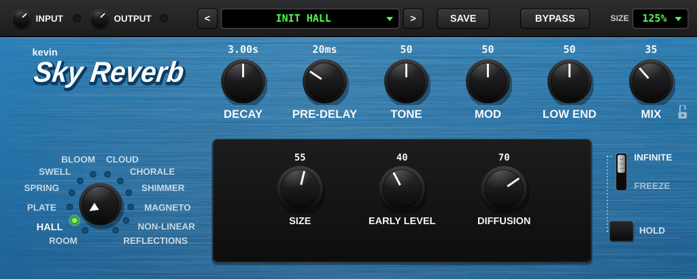

# Sky Reverb



A 12-mode stereo reverb plugin (VST3 for Studio One and other DAWs on Windows and Mac, plus AU for Logic and GarageBand), modelled on the layout and features of the Strymon BigSky pedal. It's an original design "in the spirit of" the BigSky, not a copy of Strymon's code or sound, and it doesn't use their name or logo.

## How to use it

Drag a knob up or down to turn it. Double-click any knob to reset it. The number above each knob shows its setting.

**Mode dial** (bottom left): drag it, scroll on it, or click a mode's name.

| Mode | What it is | Its own knobs (in the black window) |
|---|---|---|
| Room | A small-to-medium room | Size, Diffusion (how smooth vs. grainy), Early Level (first wall bounces) |
| Hall | A big concert hall | Size, Early Level, Diffusion |
| Plate | A classic studio plate: bright, dense, instant | Size, Diffusion |
| Spring | Amp-style spring tank, with the "boing" | Springs (1-3), Dwell (how hard you hit the springs), Tension (how twangy) |
| Swell | Every note fades in like a volume pedal | Rise Time, Swell (REVERB = only the reverb fades in, ALL = your dry sound too) |
| Bloom | The reverb builds slowly, like a flower opening | Length, Feedback |
| Cloud | A huge, soft, endless wash | Diffusion |
| Chorale | Reverb that sings with a choir-like vowel sound | Vowel (AH, EH, EE, OH, OO), Voice (LOW or HIGH), Voice Mix |
| Shimmer | Reverb that climbs up an octave (or fifth) each pass | Pitch, Amount |
| Magneto | Multi-head tape echo going into a reverb | Time, Heads (1-4), Repeats |
| Non-Linear | Reverse, 80s gated, swoosh and ramp effects | Shape, Diffusion |
| Reflections | Just the echoes off the walls of a real space | Room (Studio, Chamber, Wide, Tunnel), Position (near or far) |

**Main knobs**

- **Decay**: how long the reverb lasts (0.2 to 25 seconds). On Non-Linear it sets how long the effect is.
- **Pre-Delay**: a gap before the reverb starts, so your notes stay clear.
- **Tone**: dark to bright.
- **Mod**: gentle wobble in the reverb (chorus-like). Turn it down for a static, natural sound, up for lush movement. On Magneto it's the tape wobble.
- **Low End**: less or more bass in the reverb. Middle = natural.
- **Mix**: how much reverb. Up to the halfway point your dry sound stays at full volume, past halfway the dry sound fades out (100% = reverb only).
- **Padlock** next to Mix: when locked, changing presets keeps your Mix setting.

**Infinite / Freeze switch and HOLD button** (right side)

- Press **HOLD** to make the reverb sustain forever. Press it again to let it fade out.
- With the switch up (**INFINITE**), what you play keeps being added to the held sound.
- With the switch down (**FREEZE**), the sound is locked as it is, and you play on top of it dry.

**Top bar**

- **Input / Output**: levels in and out. The lights show your signal (they go red if it's too loud).
- **Presets**: click the green name for the menu (factory presets grouped by mode, then yours). The `<` and `>` arrows step through them.
- **SAVE**: saves the current sound as your own preset. They're stored as files in `Documents\Sky Reverb Presets` (you can copy them to another computer). Use the preset menu to delete one or open that folder.
- **BYPASS**: turns the reverb off. Whatever is ringing fades out naturally instead of cutting off. Your DAW's own bypass button does the same thing.
- **SIZE**: makes the window bigger or smaller (75% to 200%).

Everything (including the window size) is saved with your song.

## Getting the plugin file

Code has to be "compiled" (turned from text into a program the computer can run) before your DAW can load it. GitHub does this for you:

1. Open this repository on github.com and click **Actions**.
2. Click the latest run with a green tick.
3. At the bottom under **Artifacts**, download:
   - **SkyReverb-VST3-Windows** for Windows (contains `Sky Reverb.vst3`)
   - **SkyReverb-Mac-AU-VST3** for Mac (contains `Sky Reverb.vst3` and `Sky Reverb.component`)

### Install on Windows (Studio One)

1. Unzip the download and copy the whole `Sky Reverb.vst3` folder into `C:\Program Files\Common Files\VST3\`.
2. Open Studio One. Go to **Studio One > Options > Locations > VST Plug-Ins** and make sure that folder is listed (it is by default). Click **Reset Blocklist** if it doesn't show up.
3. Restart Studio One. In **Browser > Effects**, look under **Kevin > Sky Reverb** (or search "Sky") and drag it onto a track.

When you update to a newer version, close Studio One first, then replace the old `Sky Reverb.vst3` folder.

### Install on Mac

1. Unzip the download.
2. Copy `Sky Reverb.component` into `~/Library/Audio/Plug-Ins/Components/` (for Logic and GarageBand) and `Sky Reverb.vst3` into `~/Library/Audio/Plug-Ins/VST3/` (for Studio One, Ableton, etc.). (`~` means your home folder. In Finder press Cmd+Shift+G and paste the path.)
3. Because the plugin isn't from the App Store, macOS may block it. Open **Terminal** and paste this once, then press Enter:
   ```
   xattr -cr ~/Library/Audio/Plug-Ins/Components/"Sky Reverb.component" ~/Library/Audio/Plug-Ins/VST3/"Sky Reverb.vst3"
   ```
4. Restart your DAW.

## Building it yourself (optional)

You need CMake and a C++ compiler (Visual Studio 2022 "Desktop development with C++" on Windows, Xcode on Mac), plus Git. Then in this folder:

```
cmake -B build
cmake --build build --config Release --target SkyReverb_VST3
```

The first run takes a few minutes because it downloads the JUCE audio toolkit.

## Files

- `CMakeLists.txt`: the build recipe.
- `Source/dsp/ReverbEngine.cpp`: the sound. Each mode's recipe is in `configure` and `process`.
- `Source/dsp/DspBlocks.h`: the building blocks (delay lines, filters, the 8-line reverb tank, pitch shifter).
- `Source/ModeParams.h`: the list of modes and each mode's own knobs.
- `Source/Presets.cpp`: factory presets and saving your own.
- `Source/PluginEditor.cpp`: the window and how it looks.
- `tests/EngineTest.cpp`: an automatic sound test that GitHub runs on every change.
- `.github/workflows/build.yml`: the automatic GitHub build.

Built with [JUCE](https://juce.com) 8. JUCE is free for personal and small commercial use under its own licence; check juce.com if you ever plan to sell the plugin. BigSky and Strymon are trademarks of Strymon / Damage Control Engineering; this project isn't connected to them.
